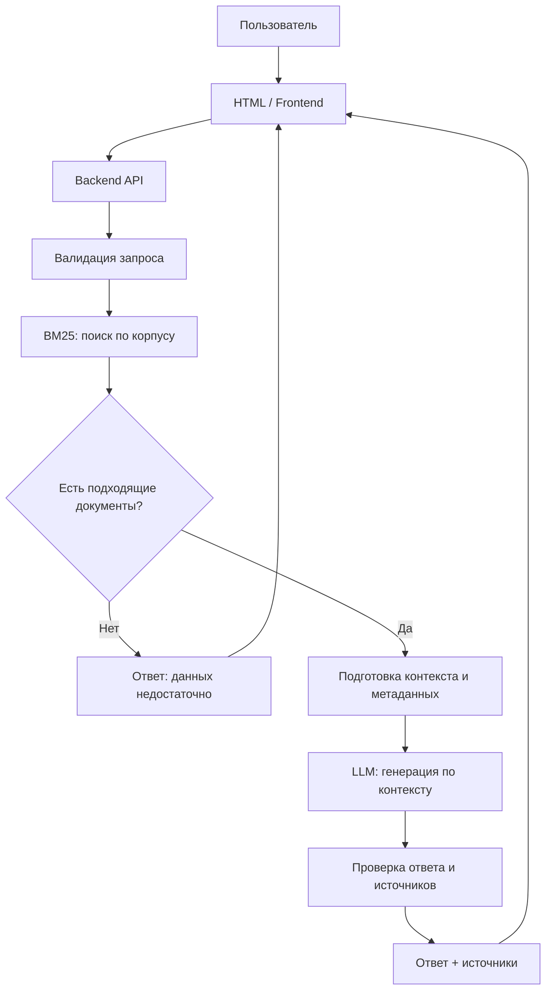

# Обзор архитектуры

**Статус:** целевая схема для последующей реализации. Это не утверждение, что перечисленные сервисы уже работают.

## 1. Принципы

- HTML/frontend не должен хранить секреты LLM-провайдера.
- Поиск и генерация изолируются за backend API.
- BM25 является базовым лексическим поиском первой версии; другие методы добавляются по результатам оценки.
- LLM получает найденные фрагменты корпуса и задачу ответить на их основе.
- Метаданные источников сохраняются рядом с текстом, чтобы их можно было показать пользователю.
- На первой контрольной точке достаточно зафиксировать архитектуру и контракт; работающий RAG не обязателен.

## 2. Компоненты

| Компонент | Ответственность | Статус на checkpoint 1 |
|---|---|---|
| Frontend (существующий HTML) | Принимает запрос, показывает состояние и результат | Есть HTML-прототип; фактическое поведение сверить |
| API/backend | Проверяет запрос, вызывает поиск и при необходимости LLM, нормализует ошибки | Проектируется |
| Корпус | Хранит очищенные документы о растениях и метаданные источников | Формат описан, наполненность проверить отдельно |
| Индекс BM25 | Находит релевантные документы по лексическому запросу | Планируется / реализуется на следующем этапе |
| Генератор ответа (LLM) | Формирует краткий ответ на основе переданного контекста | Планируется / подключается позже |
| Benchmark | Набор запросов и ожидаемых релевантных документов для оценки | Структура и начальные запросы описаны |

## 3. Поток запроса

## 4. Ответственность и контракты между компонентами

- **Frontend ↔ Backend:** frontend отправляет строку запроса и получает структурированный JSON с ответом и источниками. См. `api-contract.md`.
- **Backend ↔ Retrieval:** поисковый модуль получает нормализованный запрос и лимит выдачи, возвращает документы с ID, текстом, метаданными и оценкой релевантности.
- **Retrieval ↔ Corpus:** поисковый индекс должен быть построен из версионируемого корпуса. Для каждого документа хранится стабильный `document_id`.
- **Backend ↔ LLM:** в контекст включаются только выбранные найденные фрагменты и инструкции отвечать при недостатке данных явно.

## 5. Минимальная реализация после первой точки

1. Зафиксировать формат документов и добавить небольшой исходный корпус.
2. Реализовать подготовку текста и BM25-поиск.
3. Подключить endpoint поиска к frontend либо сначала проверить его через тестовый клиент.
4. Добавить вызов LLM за backend, не размещая секрет в браузере.
5. Передавать в интерфейс ответ и реальные источники.
6. Прогнать benchmark, зафиксировать базовые метрики и ошибки.
7. Решать вопрос о векторном поиске/RAG-гибриде только после измерения базового качества.

## 6. Границы ответственности за факты

Поиск определяет, какие документы потенциально релевантны; LLM не должен превращать отсутствие источника в утверждение. Ответ и ссылки должны быть связаны с документами, реально переданными модели. Для утверждений о токсичности, употреблении или медицинском применении необходимы особенно надёжные источники, а продукт не заменяет специалиста.
